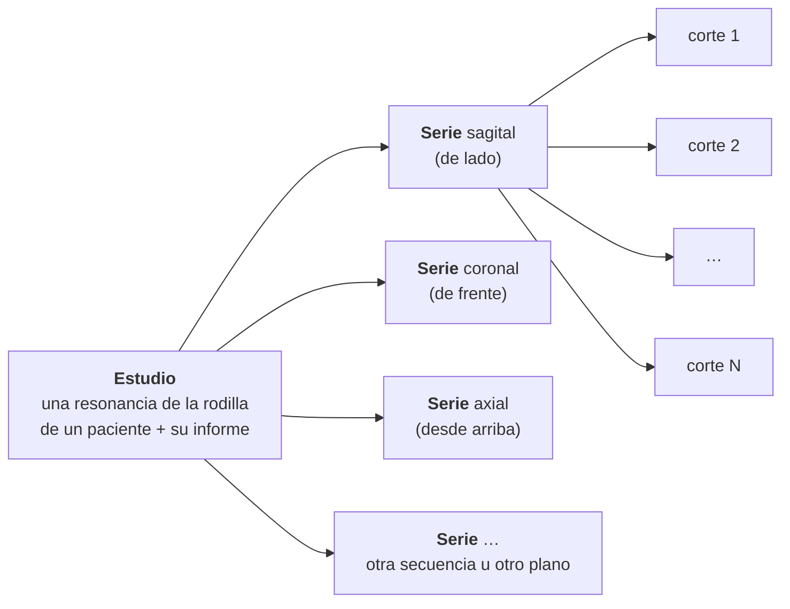

# data/

Resonancias magnéticas de rodilla en DICOM de la competición RSNA Knee Abnormality Detection, con el informe radiológico de cada estudio y 12 etiquetas de radiólogo en 58 de ellos.

Estructura al descomprimir el zip en `data/rsna/`:

```
data/rsna/
├── train.csv                 un estudio por fila: informe (Report) y 12 etiquetas (solo 58 estudios)
├── train_series.csv          una serie por fila: plano y tipo de secuencia
├── train_series/
│   └── <estudio>/<serie>/<corte>.dcm
├── test.csv
├── test_series.csv
├── test_series/
│   └── <estudio>/<serie>/<corte>.dcm
└── sample_submission.csv
```

| Archivo / carpeta | Contenido |
|---|---|
| `train.csv` | 4407 estudios. Columnas: `StudyInstanceUID`, `Report` (informe en texto libre, en varios idiomas) y los 12 hallazgos (`ACL`, `MCL`, `Medial Meniscus`, `Lateral Meniscus`, `Medial OA`, `Lateral OA`, `PF OA`, `Effusion`, `Synovitis`, `Baker's`, `Contusion`, `Fracture`). Los hallazgos (0/1) solo están rellenos en los 58 estudios gold |
| `train_series.csv` | 24 371 series. Columnas: `StudyInstanceUID`, `SeriesInstanceUID`, `Anatomical_Plane` (Sagittal, Coronal o Axial), `Fluid_Sensitive` y `Fat_Suppression` (0/1) |
| `train_series/` | Imágenes de entrenamiento: un archivo DICOM por corte (~819 000), agrupados por estudio y serie |
| `test.csv` | `StudyInstanceUID` de los estudios de test (3 de muestra; Kaggle los reemplaza por el test oculto al evaluar) |
| `test_series.csv` | Igual que `train_series.csv`, para el test |
| `test_series/` | Imágenes DICOM del test, con la misma estructura que `train_series/` |
| `sample_submission.csv` | Formato de envío: `StudyInstanceUID` y una probabilidad por cada uno de los 12 hallazgos |

## Estudio, serie, plano y corte



- **Estudio:** una sesión de resonancia de una rodilla. Tiene un informe del radiólogo y es la unidad que se clasifica: los 12 hallazgos se predicen por estudio.
- **Serie:** una adquisición dentro del estudio, en un **plano** y con un tipo de **secuencia**. Un estudio suele tener 5 series (de 3 a 14): cada plano puede tener varias, con distinta secuencia.
  - **Plano:** la dirección del corte.
    - **Sagital:** de lado. Se ven bien los ligamentos cruzados (ACL) y los meniscos.
    - **Coronal:** de frente. Se ven el MCL y los compartimentos medial y lateral.
    - **Axial:** desde arriba. Se ven la rótula y la fosa poplítea, donde está el quiste de Baker.
  - **Secuencia:** cómo se adquirió la imagen, lo que cambia el contraste. Las *sensibles a líquido* hacen brillar el agua (derrame, edema). La *supresión grasa* oscurece la grasa para que resalte el líquido.
- **Corte:** una sola imagen 2D, un archivo DICOM. Los cortes de una serie, apilados, forman el volumen 3D de la rodilla (~30 por serie).
