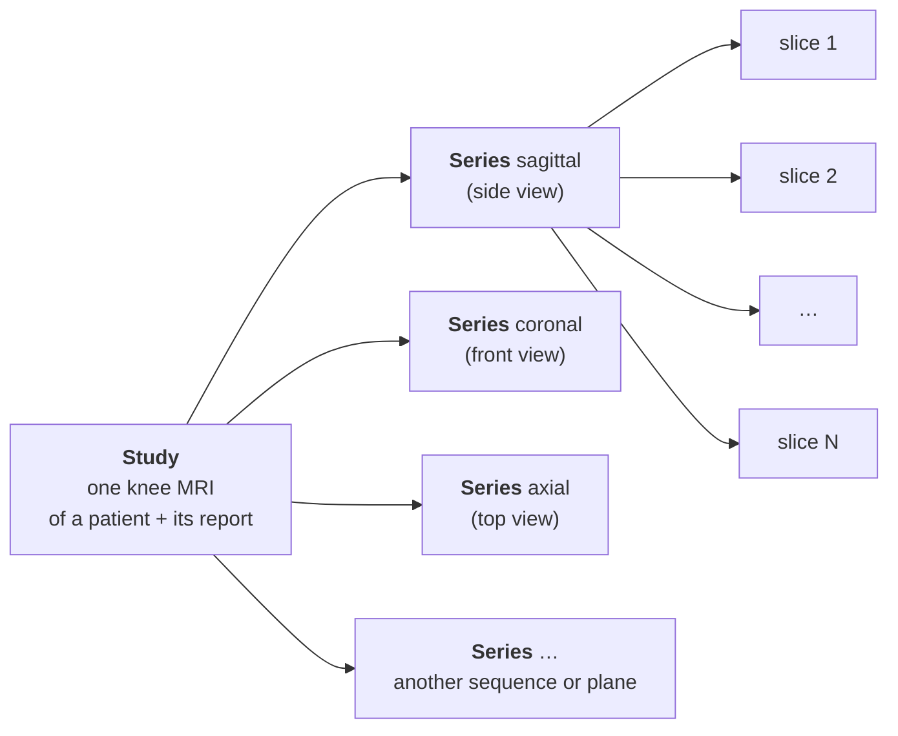

# data/

**English** · [Español](README.es.md)

Knee MRI in DICOM from the RSNA Knee Abnormality Detection competition, with the radiology report of each study and 12 radiologist labels for 58 of them.

Structure after unzipping into `data/rsna/`:

```
data/rsna/
├── train.csv                 one study per row: report (Report) and 12 labels (only 58 studies)
├── train_series.csv          one series per row: plane and sequence type
├── train_series/
│   └── <study>/<series>/<slice>.dcm
├── test.csv
├── test_series.csv
├── test_series/
│   └── <study>/<series>/<slice>.dcm
└── sample_submission.csv
```

| File / folder | Contents |
|---|---|
| `train.csv` | 4407 studies. Columns: `StudyInstanceUID`, `Report` (free-text report, in several languages) and the 12 findings (`ACL`, `MCL`, `Medial Meniscus`, `Lateral Meniscus`, `Medial OA`, `Lateral OA`, `PF OA`, `Effusion`, `Synovitis`, `Baker's`, `Contusion`, `Fracture`). The findings (0/1) are only filled in for the 58 gold studies |
| `train_series.csv` | 24 371 series. Columns: `StudyInstanceUID`, `SeriesInstanceUID`, `Anatomical_Plane` (Sagittal, Coronal or Axial), `Fluid_Sensitive` and `Fat_Suppression` (0/1) |
| `train_series/` | Training images: one DICOM file per slice (~819 000), grouped by study and series |
| `test.csv` | `StudyInstanceUID` of the test studies (3 samples; Kaggle replaces them with the hidden test set when scoring) |
| `test_series.csv` | Same as `train_series.csv`, for the test set |
| `test_series/` | Test DICOM images, with the same structure as `train_series/` |
| `sample_submission.csv` | Submission format: `StudyInstanceUID` and one probability for each of the 12 findings |

## Study, series, plane and slice



- **Study:** one MRI session of one knee. It has a radiologist report and is the unit we classify: the 12 findings are predicted per study.
- **Series:** one acquisition within the study, in one **plane** and with one **sequence** type. A study usually has 5 series (3 to 14): each plane can have several, with different sequences.
  - **Plane:** the direction of the cut.
    - **Sagittal:** side view. Shows the cruciate ligaments (ACL) and the menisci well.
    - **Coronal:** front view. Shows the MCL and the medial and lateral compartments.
    - **Axial:** top view. Shows the patella and the popliteal fossa, where Baker's cysts sit.
  - **Sequence:** how the image was acquired, which changes the contrast. *Fluid-sensitive* sequences make water bright (effusion, edema). *Fat suppression* darkens fat so that fluid stands out.
- **Slice:** a single 2D image, one DICOM file. Stacked, the slices of a series form the 3D volume of the knee (~30 per series).
