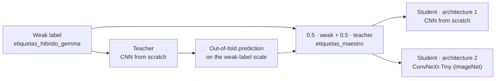

# entrenamiento/ (training)

**English** · [Español](README.es.md)

Trains both architectures with the teacher-student scheme, in 5 folds.

```bash
uv run python -m entrenamiento.entrenar todo   # with uv
python -m entrenamiento.entrenar todo          # with pip (with the .venv environment activated)
```

One stage or some folds: `python -m entrenamiento.entrenar maestro 0 1` (stages: `maestro` = teacher, `etiquetas` = teacher labels, `alumno` = CNN student, `convnext` = ConvNeXt student).

| File | Contents |
|---|---|
| `comun.py` | 2.5D dataset (full view + zoom), both networks, focal loss and training loop |
| `entrenar.py` | The 4 teacher-student stages |



**Input:** 12 evenly spaced slices per plane; each slice with its 2 neighbors as RGB channels (2.5D). Each of the 36 images enters twice: full view (150 mm) and zoomed on the central 100 mm, both at 224 px. The network pools the 72 with mean and max and outputs 12 sigmoids.

| | Architecture 1 | Architecture 2 |
|---|---|---|
| Network | CNN from scratch: stem + 4 stages of 3×3 convs + feature pyramid (1.25 M parameters) | ConvNeXt-Tiny pretrained on ImageNet (27.9 M) |
| Epochs | 30 | 15 |
| Learning rate | 10⁻³ | 10⁻⁴ for the backbone, 10⁻³ for the head |
| Batch | 8 studies | 2 studies × 4 accumulation steps |

Shared by both: focal loss (γ = 2), AdamW with OneCycle, validation against the weak label and gold kept apart.

Each model is saved in `data/runs/<stage>_f<fold>/` (`modelo.pt`, `historial.csv`, `checkpoint.pt`). The checkpoint is saved every epoch: if training stops, the same command resumes it. With `PARAR_EN=N` training pauses at the end of epoch N.

On a 48 GB GPU: ~1 h per CNN fold and ~1 h per ConvNeXt fold, about 15 h in total.
