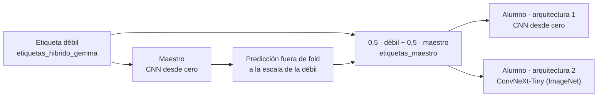

# entrenamiento/

Entrena las dos arquitecturas con el esquema maestro-alumno, en 5 folds.

```bash
uv run python -m entrenamiento.entrenar todo   # con uv
python -m entrenamiento.entrenar todo          # con pip (con el entorno .venv activado)
```

Una etapa o algunos folds: `python -m entrenamiento.entrenar maestro 0 1` (etapas: `maestro`, `etiquetas`, `alumno`, `convnext`).

| Archivo | Qué contiene |
|---|---|
| `comun.py` | Dataset 2.5D (vista completa + zoom), las dos redes, pérdida focal y bucle de entrenamiento |
| `entrenar.py` | Las 4 etapas del maestro-alumno |



**Entrada:** de cada plano, 12 cortes repartidos; cada corte con sus 2 vecinos como canales RGB (2.5D). Cada una de las 36 imágenes entra dos veces: completa (150 mm) y con zoom a los 100 mm centrales, ambas a 224 px. La red resume las 72 con media y máximo y da 12 salidas sigmoides.

| | Arquitectura 1 | Arquitectura 2 |
|---|---|---|
| Red | CNN desde cero: stem + 4 etapas de conv 3×3 + pirámide (1,25 M parámetros) | ConvNeXt-Tiny preentrenada en ImageNet (27,9 M) |
| Épocas | 30 | 15 |
| Learning rate | 10⁻³ | 10⁻⁴ en la red, 10⁻³ en la cabeza |
| Lote | 8 estudios | 2 estudios × 4 de acumulación |

Común a las dos: pérdida focal (γ = 2), AdamW con OneCycle, validación contra la etiqueta débil y gold aparte.

Cada modelo se guarda en `data/runs/<etapa>_f<fold>/` (`modelo.pt`, `historial.csv`, `checkpoint.pt`). El checkpoint es por época: si se interrumpe, el mismo comando lo retoma. Con `PARAR_EN=N` el entrenamiento se pausa al terminar la época N.

Con una GPU de 48 GB: ~1 h por fold de la CNN y ~1 h por fold de ConvNeXt, unas 15 h en total.
