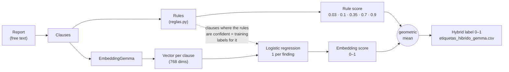

# etiquetas/ (labels)

**English** · [Español](README.es.md)

Weak labels for the 12 findings from the radiology reports (free text, several languages), for the 4349 studies without radiologist labels (*silver*). The **gold** labels (58 studies, from radiologists) are only used to evaluate them.

```bash
uv run python -m etiquetas.generar   # with uv
python -m etiquetas.generar          # with pip (with the .venv environment activated)
```

| Order | Script | What it does | Output in `data/etiquetas/` |
|---|---|---|---|
| 0 | `gold.py` | Extracts the 58 radiologist-labeled studies | `gold.csv` |
| 1 | `reglas.py` | Multilingual rules on each clause of the report | `etiquetas_reglas.csv` |
| 2 | `embeddings.py` | Hybrid rules + EmbeddingGemma (downloaded automatically, 1.2 GB) | `etiquetas_hibrido_gemma.csv` |
| 3 | `evaluar.py` | Validation against gold | per-finding table |



| Source | AUC | Agreement | Noise | Kappa |
|---|---:|---:|---:|---:|
| Rules | 0.816 | 81.3 % | 18.7 % | 0.538 |
| Hybrid (used for training) | 0.856 | 82.2 % | 17.8 % | 0.578 |

The hybrid combination was chosen against gold among several (mean, weighted means, maximum, rank mean and geometric mean). To check that the gain is not chance, it was chosen on 4/5 of gold and measured on the remaining 1/5: 0.857 versus 0.847 for the plain mean.

`precalculadas/` holds the labels the models were trained with: rules, hybrid and teacher labels (`etiquetas_maestro.csv`, produced by `entrenamiento/`). To use them without regenerating:

```bash
mkdir -p data/etiquetas && cp etiquetas/precalculadas/*.csv data/etiquetas/
uv run python -m etiquetas.gold   # gold.csv comes from train.csv
```

With `etiquetas_maestro.csv` the students can be trained without training the teachers first: `python -m entrenamiento.entrenar alumno` and `convnext`.
