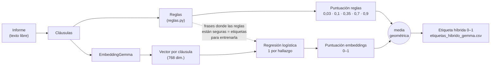

# etiquetas/

Etiquetas débiles de los 12 hallazgos a partir de los informes radiológicos (texto libre, varios idiomas), para los 4349 estudios sin etiqueta de radiólogo (*silver*). Las etiquetas **gold** (58 estudios, de radiólogos) solo se usan para evaluarlas.

```bash
uv run python -m etiquetas.generar   # con uv
python -m etiquetas.generar          # con pip (con el entorno .venv activado)
```

| Orden | Script | Qué hace | Salida en `data/etiquetas/` |
|---|---|---|---|
| 1 | `reglas.py` | Reglas multilingües sobre cada cláusula del informe | `etiquetas_reglas.csv` |
| 2 | `embeddings.py` | Híbrido reglas + EmbeddingGemma (se descarga solo, 1,2 GB) | `etiquetas_hibrido_gemma.csv` |
| 3 | `evaluar.py` | Validación contra gold | tabla por hallazgo |



| Fuente | AUC | Acuerdo | Ruido | Kappa |
|---|---:|---:|---:|---:|
| Reglas | 0,816 | 81,3 % | 18,7 % | 0,538 |
| Híbrido (se usa para entrenar) | 0,856 | 82,2 % | 17,8 % | 0,578 |

La combinación del híbrido se eligió contra gold entre varias (media, medias ponderadas, máximo, media de rangos y media geométrica). Para comprobar que la mejora no es casualidad, se eligió con 4/5 de gold y se midió en el 1/5 restante: 0,857 frente a 0,847 de la media simple.

`precalculadas/` tiene las etiquetas con las que se entrenaron los modelos: reglas, híbrido y las del maestro (`etiquetas_maestro.csv`, que genera `entrenamiento/`). Para usarlas sin regenerar:

```bash
mkdir -p data/etiquetas && cp etiquetas/precalculadas/*.csv data/etiquetas/
uv run python -m etiquetas.gold   # gold.csv sale de train.csv
```

Con `etiquetas_maestro.csv` se pueden entrenar los alumnos sin entrenar antes los maestros: `python -m entrenamiento.entrenar alumno` y `convnext`.
