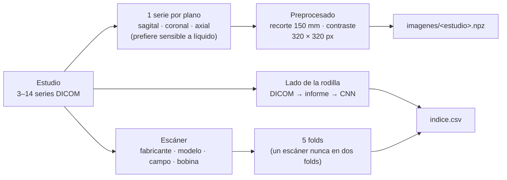

# imagenes/

Convierte los DICOM de `data/rsna/` en un volumen por plano y estudio, listo para entrenar, y arma los folds de validación cruzada.

```bash
uv run python -m imagenes.generar   # con uv
python -m imagenes.generar          # con pip (con el entorno .venv activado)
```

| Orden | Script | Qué hace | Salida en `data/` |
|---|---|---|---|
| 1 | `preparar.py` | Elige una serie por plano, la preprocesa y arma los folds | `imagenes/*.npz`, `series.csv`, `indice.csv` |
| 2 | `lateralidad.py` | Completa con una CNN el lado de la rodilla que falta | `indice.csv` (lado final), `modelos/lateralidad_cnn.pt` |



**Folds:** los 4349 estudios silver se reparten en 5 grupos (`GroupKFold`) agrupando por escáner. Así el modelo siempre se valida en escáneres que no vio, como pasa con el test de Kaggle, que viene de otros centros. Los 58 gold llevan `fold = -1` y no se usan para entrenar.

**Lado:** al cargar, las rodillas izquierdas se reflejan para que medial y lateral queden siempre en el mismo lado de la imagen.

