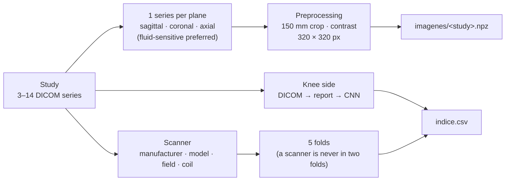

# imagenes/ (images)

**English** · [Español](README.es.md)

Converts the DICOM files in `data/rsna/` into one volume per plane and study, ready for training, and builds the cross-validation folds.

```bash
uv run python -m imagenes.generar   # with uv
python -m imagenes.generar          # with pip (with the .venv environment activated)
```

| Order | Script | What it does | Output in `data/` |
|---|---|---|---|
| 1 | `preparar.py` | Picks one series per plane, preprocesses it and builds the folds | `imagenes/*.npz`, `series.csv`, `indice.csv` |
| 2 | `lateralidad.py` | Fills in the missing knee side with a CNN | `indice.csv` (final side), `modelos/lateralidad_cnn.pt` |



**Folds:** the 4349 silver studies are split into 5 groups (`GroupKFold`) grouped by scanner. The model is therefore always validated on scanners it has not seen, as happens with the Kaggle test set, which comes from other centers. The 58 gold studies have `fold = -1` and are never used for training.

**Side:** when loading, left knees are mirrored so that medial and lateral always sit on the same side of the image.
